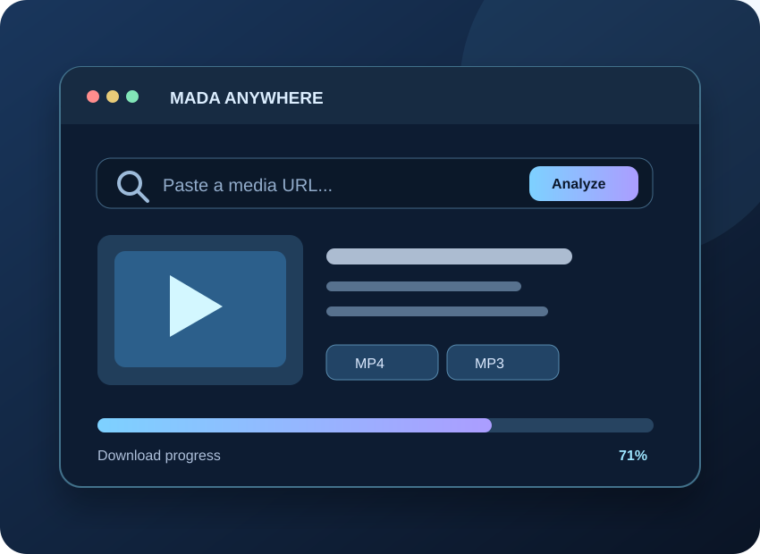

<div align="center">



# MADA Anywhere
**Your media, anywhere · وسائطك في مكان واحد**

[](MADA_Anywhere_v2.zip)


### [🌐 Website](https://attack988.github.io/MADA-Anywhere/) · [📦 Download ZIP](MADA_Anywhere_v2.zip) · [📖 Full instructions](README_AR_EN.md)

*Illustrative interface preview, not a capture of a live download.*

</div>

---

## 🇸🇦 ما هو MADA Anywhere؟

تطبيق عربي وإنجليزي لتصفح معلومات الروابط المدعومة وتنزيل **الفيديو والصوت المسموح لك بحفظهما** باستخدام Python و`yt-dlp`. يمكنك اختيار الصيغة والجودة المتاحة ومتابعة حالة التحميلات من واجهة متجاوبة.

### المميزات

| | الميزة |
|---|---|
| 🔗 | تحليل الروابط المدعومة وعرض تفاصيل الوسائط |
| 🎞️ | اختيار MP4 أو MP3 أو M4A عند توفرها |
| 📉 | قائمة تحميلات، التقدم وإعادة المحاولة |
| 📱 | واجهة PWA عربية وإنجليزية على الهاتف والكمبيوتر |
| 🔐 | اتصال اختياري بخادم خاص عبر HTTPS ورمز وصول |

### التثبيت السريع على Ubuntu

بعد تنزيل وفك ضغط [MADA Anywhere v2](MADA_Anywhere_v2.zip) افتح Terminal داخل المجلد:

```bash
sudo apt install -y python3-venv ffmpeg
bash install_ubuntu_mac.sh
bash start_ubuntu_mac.sh
```

ثم افتح `http://127.0.0.1:8787`.

| المنصة | طريقة التشغيل |
|---|---|
| Linux / Ubuntu | خادم Python محلي |
| Windows | `install_windows.bat` ثم `start_windows.bat` |
| macOS | `install_ubuntu_mac.sh` و`start_ubuntu_mac.sh` |
| Android | Termux أو خادم HTTPS خاص |
| iPhone / iPad | واجهة PWA فقط؛ تحتاج خادم تنزيل HTTPS خارجيًا |

**تنبيه:** هذا المشروع تجريبي، وليس APK أو IPA. موقع GitHub Pages يعرض صفحة التعريف فقط؛ لا يشغّل محرك التنزيل. جودة التنزيل ودعم المواقع يعتمدان على المصدر. لا يتجاوز DRM، واستخدمه فقط لتنزيل المحتوى الذي تملك حق حفظه.

---

## 🇬🇧 English

MADA Anywhere is an experimental, bilingual media download manager. Inspect supported links, choose available formats, and view download progress via a responsive UI. Processing runs on Python and `yt-dlp`.

**Install:** Download the [source ZIP](MADA_Anywhere_v2.zip). On Ubuntu, install Python, a virtual environment, and FFmpeg, then run `bash install_ubuntu_mac.sh` and `bash start_ubuntu_mac.sh`. For Windows, macOS and Android, see [README_AR_EN.md](README_AR_EN.md).

**Mobile:** The interface can be opened or installed as a PWA. iOS requires a separate secure HTTPS backend for media processing. The app does not bypass DRM. Only save content you are permitted to download.

**Projects are separate:** This repository contains **MADA Anywhere only**, not the MADA Universal Games launcher.
